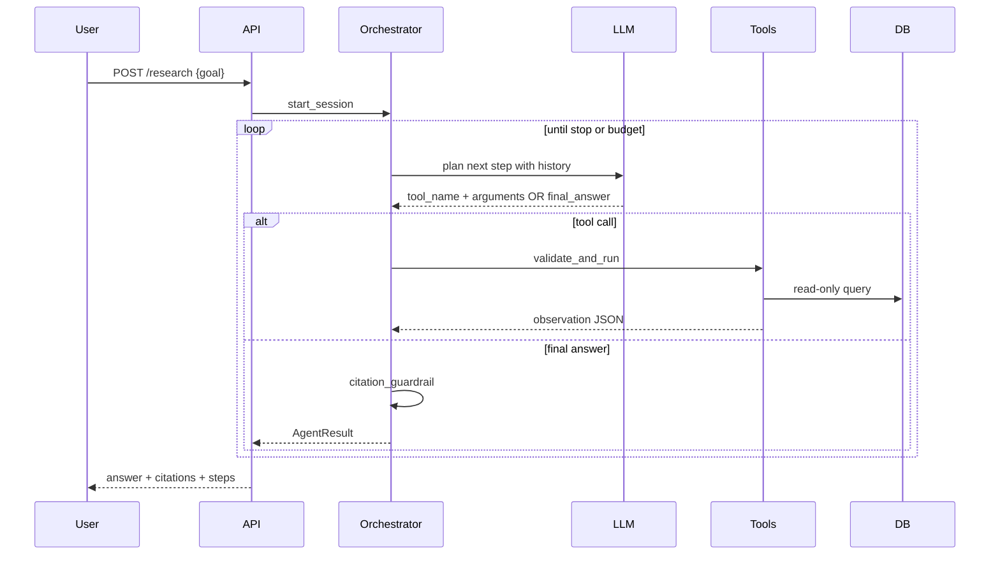

# Agent workflow

## Overview

The agent follows a **Plan → Act → Observe** loop (ReAct-style) with explicit structured tool calls.



## State machine

| State | Description | Next |
| --- | --- | --- |
| `INIT` | Load settings, verify `AGENT_ENABLED` | `PLAN` |
| `PLAN` | LLM chooses tool or finish | `ACT` or `FINALIZE` |
| `ACT` | Execute tool | `OBSERVE` |
| `OBSERVE` | Append observation to memory | `PLAN` |
| `FINALIZE` | Validate citations | `DONE` |
| `FAILED` | Unrecoverable error | `DONE` |

## Reasoning contract (prompt-level)

The planner prompt must instruct the model to:

1. Prefer `search_chunks` before `get_chunk`.
2. Cite chunk ids present in observations only.
3. Stop when evidence is sufficient or budget is near limit.
4. Say “insufficient evidence” rather than invent facts.

Prompt templates: [PROMPT_ENGINEERING.md](./PROMPT_ENGINEERING.md).

## Memory per step

Each step record:

```json
{
  "step_index": 1,
  "thought": "Need rollback section",
  "tool": "search_chunks",
  "tool_input": {"query": "rollback database", "top_k": 3},
  "observation_summary": "3 chunks returned",
  "duration_ms": 120
}
```

Full observations stored in session memory ([MEMORY_ARCHITECTURE.md](./MEMORY_ARCHITECTURE.md)).

## Stop conditions

- LLM returns `final_answer` with valid citations
- `tool_calls >= AGENT_MAX_TOOL_CALLS`
- `elapsed >= AGENT_MAX_WALL_CLOCK_SECONDS`
- Repeated identical tool call (loop detection — implement in Phase 7)

## Error recovery

| Error | Recovery |
| --- | --- |
| Invalid tool name | Return error observation; replan |
| Invalid JSON args | One repair attempt with schema hint |
| Empty search | Observation notes empty; replan or finalize |
| LLM timeout | Fail session with partial trace |

Details: [ERROR_HANDLING.md](./ERROR_HANDLING.md).

## Implementation files (planned)

| File | Role |
| --- | --- |
| `backend/app/agents/orchestrator.py` | Main loop |
| `backend/app/agents/tool_runner.py` | Dispatch + validate |
| `backend/app/agents/prompts/planner.md` | System + user templates |
| `backend/app/agents/session_memory.py` | In-memory or SQLite session |

## Debugging

1. Enable `LOG_LEVEL=DEBUG`.
2. Inspect step trace in API response `steps` array.
3. Re-run with same `conversation_id` if persistence enabled.
