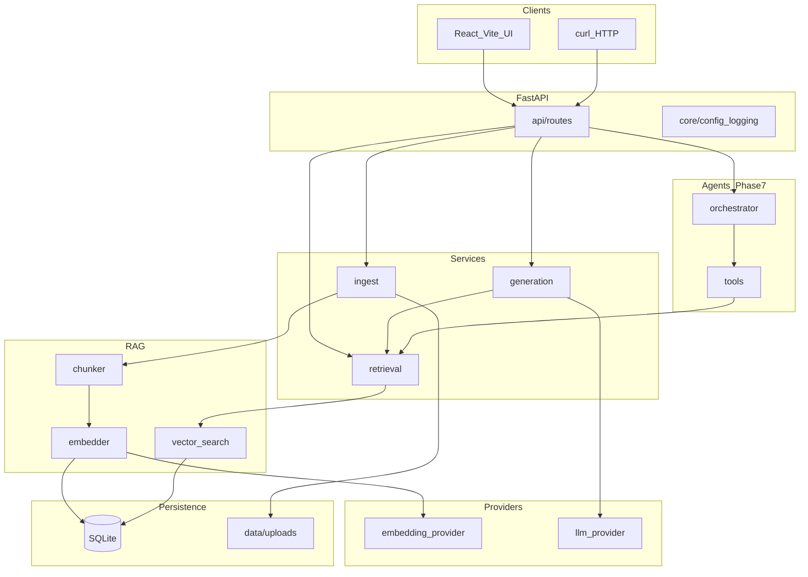

# System architecture

## High-level view

## Layer responsibilities

| Layer | Path | Responsibility |
| --- | --- | --- |
| API | `backend/app/api/routes/` | HTTP validation, status codes, DTO mapping |
| Core | `backend/app/core/` | Settings, logging, dependencies, exceptions |
| Models | `backend/app/models/` | Pydantic schemas + SQLAlchemy/table models |
| Services | `backend/app/services/` | Business orchestration |
| RAG | `backend/app/rag/` | Chunking, embedding glue, search math |
| Agents | `backend/app/agents/` | Tool loop, planning prompts |
| Providers | `backend/app/providers/` | Swappable embedding and LLM backends |

## Request flows

### Ingest flow

1. `POST /api/v1/documents` receives multipart file.
2. Service saves file to `data/uploads/{uuid}_{name}`.
3. Text extracted → row in `documents`.
4. Chunker produces rows in `chunks`.
5. Embedder writes vectors to `chunk_embeddings`.
6. Response returns `document_id`, chunk count.

### Ask flow (RAG)

1. `POST /api/v1/ask` with `{ "question": "...", "session_id": optional }`.
2. Embed question (same provider as corpus).
3. Cosine similarity vs chunks → top-k (`search_service`; fake provider skips uncalibrated score cutoff at search time).
4. **`assess_retrieval_sufficiency`** — lexical overlap (+ similarity for `local` embeddings). If weak → `insufficient_evidence: true`, empty citations, **no LLM call**.
5. Build context from retrieved chunks; LLM provider (mock/Ollama) generates answer with chunk ids.
6. **`build_citations`** — only chunk ids from retrieval map; response includes citations + optional session persistence.

See [RAG_ARCHITECTURE.md](./RAG_ARCHITECTURE.md) and `backend/app/rag/evidence_policy.py`.

### Frontend ↔ API

- Vite dev server proxies `/health` and `/api` to `127.0.0.1:8000`.
- Client resolves API base: same-origin proxy, then direct `http://127.0.0.1:8000` fallback (`frontend/src/lib/api/client.ts`).
- Connection pill polls health every 5s (`useApiConnection`).

### Agent flow (Phase 7)

1. `POST /api/v1/research` with goal + optional document scope.
2. Orchestrator loop: plan → tool call → observe → repeat until stop condition.
3. Tools limited to: `search_chunks`, `get_chunk`, `list_documents` (see [TOOL_USAGE.md](./TOOL_USAGE.md)).
4. Final synthesis must pass citation guardrail check.

## Component interactions

| From | To | Contract |
| --- | --- | --- |
| Routes | Services | Python calls; no HTTP inside monolith |
| Retrieval | RAG search | `SearchResult(chunks, scores)` |
| Generation | Retrieval | Requires pre-fetched context bundle |
| Agent tools | Retrieval | Read-only |
| All layers | Core settings | `get_settings()` singleton |

## Deployment unit (target)

Single container or process running Uvicorn; optional second container for Ollama; static frontend served by CDN or same host.

Details: [DEPLOYMENT.md](./DEPLOYMENT.md).

## Technology choices (summary)

See [DECISION_LOG.md](./DECISION_LOG.md) for rationale.

- FastAPI + Uvicorn
- SQLite + file storage
- sentence-transformers (local CPU)
- Mock / Ollama LLM

## Future extensions

- Postgres + pgvector
- OpenTelemetry tracing ([OBSERVABILITY.md](./OBSERVABILITY.md))
- Separate worker for async ingest queue
