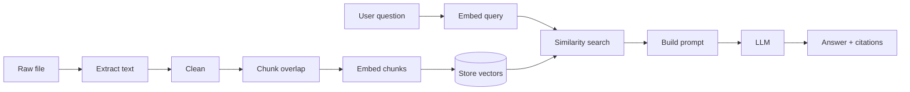

# RAG architecture

## Definition

**RAG (Retrieval-Augmented Generation)** = retrieve relevant document passages, then generate an answer **conditioned on those passages**, with citations.

Hinglish: *Pehle sahi paragraph dhoondo, phir usi par jawab likho — bina dhoondhe mat likho.*

## Pipeline stages



## Stage details

### 1. Extract and clean

- Input: `.txt`, `.md` bytes
- Remove null bytes, normalize `\r\n` → `\n`, collapse excessive blank lines
- Output: single `content_text` on document row

### 2. Chunking

- **Chunk** = fixed-size character window (default 800 chars)
- **Overlap** = shared tail/head (default 120 chars) so sentences split across boundaries still appear whole in at least one chunk
- Each chunk: `index` (0..n), `text`, `document_id`

### 3. Embedding

- Model: `all-MiniLM-L6-v2` → 384-dimensional float vector
- Store: `embedding_model`, `embedding_version`, vector BLOB
- Same model must embed queries at search time

### 4. Retrieval

- Score: **cosine similarity** between query vector and each chunk vector
- Select top `RETRIEVAL_TOP_K` (default 5)
- Optional filter: drop if score < `MIN_SIMILARITY_SCORE`

Cosine formula (interview):

\[
\text{sim}(a,b) = \frac{a \cdot b}{\|a\| \|b\|}
\]

### 5. Generation

- System: answer only from provided context; cite chunk ids
- User: question
- Context block: numbered chunks with ids

### 6. Citations

Response includes:

```json
{
  "citations": [
    {
      "chunk_id": "...",
      "document_id": "...",
      "filename": "runbook.md",
      "snippet": "...",
      "score": 0.82
    }
  ]
}
```

## Hybrid retrieval (Phase 9)

Combine:

- **Dense**: embedding similarity (semantic)
- **Sparse**: BM25 / FTS on keywords (exact terms like error codes)

Fusion: reciprocal rank fusion (RRF) or weighted sum — measure on golden set before defaulting.

## Reranking (Phase 9)

Cross-encoder reranker on top 20 → final top 5. Justify only if recall@5 improves on fixtures.

## Evaluation hooks

| Metric | Meaning |
| --- | --- |
| recall@k | Golden chunk in top k results |
| MRR | Mean reciprocal rank of first correct chunk |
| Citation validity | Every cited id was retrieved |
| Groundedness (manual/LLM-judge) | Answer supported by cited text |

See [AGENT_EVALUATION.md](./AGENT_EVALUATION.md).

## Module map (planned)

| Module | Path |
| --- | --- |
| Chunker | `backend/app/rag/chunker.py` |
| Embedder service | `backend/app/rag/embedder.py` |
| Search | `backend/app/rag/vector_search.py` |
| Ingest orchestration | `backend/app/services/ingest/` |
| Ask orchestration | `backend/app/services/generation/` |

## Common failures

| Symptom | Likely cause |
| --- | --- |
| Wrong answers with high confidence | Chunk too large; irrelevant context |
| “No results” | Threshold too high or wrong embedding model |
| Missing fact on boundary | Overlap too small |
| Slow search | Too many chunks — add index or ANN later |

## Interview soundbite

“We own the full RAG path: chunk overlap for recall, cosine retrieval for MVP, prompt-delimited context for groundedness, and automated citation checks.”
