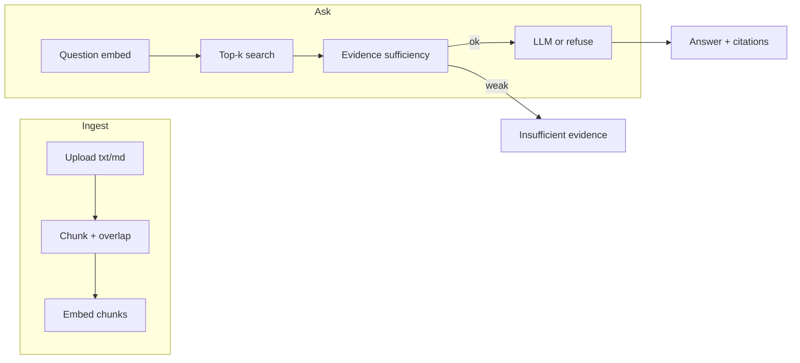

# Grounded Research Desk

**Local-first RAG research platform** — ingest text documents, retrieve grounded passages, and answer with citations. Built for learning, technical interviews, and portfolio demos without mandatory paid APIs.

**Repository:** [github.com/samikshachauhan781-lang/grounded-research-desk](https://github.com/samikshachauhan781-lang/grounded-research-desk)

---

## Project overview

Grounded Research Desk is a full-stack MVP that implements a document-grounded question-answering pipeline: upload → chunk → embed → retrieve → evidence check → generate (or refuse). A React **Evidence Atlas** UI exposes research, library, search, history, collections, evaluation runs, and an optional bounded agent.

**Core promise:** *Research with evidence. Every answer traceable to its source.*

---

## Key features

| Feature | Description |
| --- | --- |
| **Document ingest** | Upload `.txt` and `.md` files; chunking with overlap; SQLite persistence |
| **Retrieval** | Top-k chunk search (cosine similarity; provider-dependent vectors) |
| **Grounded answers** | `/api/v1/ask` with citations tied to retrieved chunks |
| **Evidence gate** | `assess_retrieval_sufficiency()` blocks weak matches — **no LLM call**, empty citations |
| **Research workspace** | Ask flow with Evidence Rail; sessions saved when `session_id` is used |
| **Semantic search UI** | Dedicated search page over the corpus |
| **Collections** | Named document groups via API + **Collections** page |
| **History** | Session list and detail (**History** in sidebar) |
| **Observatory** | Trigger evaluation runs against golden Q&A pairs (`tests/golden/qa_pairs.json`) |
| **Research agent** | Tool-bounded agent on `/api/v1/research` when `AGENT_ENABLED=true` (default **off**) |
| **Research Desk Guide** | In-app FAQ panel (deterministic guide engine, not a live LLM chatbot) |

**Not in MVP:** PDF ingest, authentication, hybrid/reranked search, public production hardening.

---

## Status

| Area | State |
| --- | --- |
| Backend RAG MVP | **33 pytest tests** (fake embeddings + mock LLM in CI and local default) |
| Evidence Atlas UI | **6 Vitest** unit tests; **production build**; **4 Playwright E2E tests** (local only; run `npx playwright install`) |
| GitHub Actions CI | **Passing** on `main` (backend `pytest tests/ -q`, frontend `npm run test:unit` + `npm run build`). **Playwright not run in CI.** |
| Docker Compose | Compose file ships with fake + mock defaults. **Docker image build not verified** in CI or this repo audit. |
| Public production | **Not ready** — no authentication |

See [CURRENT_STATE.md](./CURRENT_STATE.md) for implementation notes.

---

## Technology stack

| Layer | Technologies |
| --- | --- |
| **API** | Python 3.11+, FastAPI, Uvicorn, Pydantic v2, pydantic-settings |
| **Data** | SQLAlchemy 2, SQLite (`data/grounded_research.db`), local file uploads |
| **RAG** | Custom chunker, NumPy cosine search, swappable embedding + LLM providers |
| **Optional ML** | `sentence-transformers` (`.[local]` extra), Ollama HTTP API for generation |
| **Frontend** | React 19, TypeScript, Vite 6, React Router 7 |
| **Testing** | pytest, Vitest, Playwright |
| **CI** | GitHub Actions (`.github/workflows/ci.yml`) |

---

## RAG architecture and workflow



1. **Ingest** — `POST /api/v1/documents` saves the file, extracts text, chunks (`CHUNK_SIZE_CHARS` / overlap), embeds via the configured provider, stores rows in SQLite.
2. **Retrieve** — The question is embedded with the **same provider** as the corpus; cosine similarity ranks chunks (`search_service`).
3. **Evidence sufficiency** — `assess_retrieval_sufficiency()` in `backend/app/rag/evidence_policy.py`:
   - **`EMBEDDING_PROVIDER=fake` (default demo):** requires lexical overlap between question and top snippet ≥ `EVIDENCE_MIN_LEXICAL_OVERLAP`; fake scores are **not** treated as semantic similarity alone.
   - **`EMBEDDING_PROVIDER=local`:** requires top cosine ≥ `MIN_SIMILARITY_SCORE` **and** lexical overlap.
   - If insufficient: `insufficient_evidence: true`, standardized message, **empty citations**, **no LLM call**.
4. **Generate** — Mock or Ollama provider receives delimited **untrusted** evidence blocks (`prompt_guard`); citations are built only from retrieved chunk IDs (`build_citations`).

The research **agent** reuses the same sufficiency gate before generation and runs a fixed tool allowlist when `AGENT_ENABLED=true`.

---

## Demo mode vs real providers

| Setting | Default (demo / CI) | Optional real stack |
| --- | --- | --- |
| **`EMBEDDING_PROVIDER`** | `fake` — deterministic vectors + lexical gate | `local` — install `pip install -e ".[local]"`, uses sentence-transformers |
| **`LLM_PROVIDER`** | `mock` — template answer from retrieved snippets | `ollama` — requires running Ollama and a pulled model matching `OLLAMA_MODEL` |

Fake embeddings are **not** neural semantic embeddings. The mock LLM is **not** a hosted or local generative model — it formats grounded text from chunks for deterministic demos and tests.

Copy defaults from `.env.example` or set env vars explicitly (see [CONFIGURATION.md](./CONFIGURATION.md)).

---

## Project structure

```
grounded-research-desk/
├── backend/app/
│   ├── api/routes/       # FastAPI routers (documents, ask, search, …)
│   ├── agents/           # Bounded research agent + tools
│   ├── core/             # Settings, logging, dependencies
│   ├── database/         # SQLAlchemy models + session
│   ├── models/           # Pydantic API schemas
│   ├── providers/        # Embedding + LLM backends
│   ├── rag/              # Chunker, vector search, evidence policy
│   └── services/         # Ingest, retrieval, generation, eval, sessions
├── frontend/src/
│   ├── features/         # Research, Library, History, Agent, Observatory, …
│   ├── components/       # Evidence Rail, shell, UI primitives
│   └── lib/api/          # Typed API client
├── tests/                # pytest unit + integration; golden eval fixtures
├── docker/               # Dockerfile + compose (API only)
├── scripts/              # measure_ask_latency.py
└── .github/workflows/    # CI
```

Runtime data (gitignored): `data/grounded_research.db`, `data/uploads/`.

---

## API overview

Default prefix: **`/api/v1`** (`API_PREFIX`). Health routes are at the app root.

| Method | Path | Purpose |
| --- | --- | --- |
| GET | `/health` | Liveness (`status: ok`) |
| GET | `/health/ready` | DB readiness |
| POST | `/api/v1/documents` | Upload document |
| GET | `/api/v1/documents` | List documents |
| GET | `/api/v1/documents/{id}` | Document metadata |
| GET | `/api/v1/documents/{id}/content` | Full text |
| GET | `/api/v1/documents/{id}/chunks` | Chunks |
| POST | `/api/v1/documents/{id}/reprocess` | Re-ingest |
| DELETE | `/api/v1/documents/{id}` | Delete document |
| POST | `/api/v1/search` | Semantic search |
| POST | `/api/v1/ask` | Grounded Q&A |
| POST | `/api/v1/collections` | Create collection |
| GET | `/api/v1/collections` | List collections |
| GET/PATCH/DELETE | `/api/v1/collections/{id}` | Manage collection |
| POST/DELETE | `/api/v1/collections/{id}/documents[...]` | Membership |
| POST | `/api/v1/sessions` | Create research session |
| GET | `/api/v1/sessions` | List sessions |
| GET | `/api/v1/sessions/{id}/messages` | Session Q&A history |
| DELETE | `/api/v1/sessions/{id}` | Delete session |
| GET | `/api/v1/evaluations/datasets` | Eval datasets |
| POST | `/api/v1/evaluations/runs` | Run golden eval |
| GET | `/api/v1/evaluations/runs[...]` | Eval run history |
| POST | `/api/v1/research` | Agent research (requires `AGENT_ENABLED`) |
| POST | `/api/v1/agent/runs` | Alias for `/research` |
| GET | `/api/v1/settings/public` | Public config snapshot |
| GET | `/api/v1/system/status` | System + corpus counts |
| GET | `/api/v1/activity` | Activity feed |

OpenAPI: `/docs` when `APP_ENV=development`.

Full contract: [API_CONTRACT.md](./API_CONTRACT.md).

---

## Prerequisites

- Python **3.11+**
- Node **20+**
- (Optional) `pip install -e ".[local]"` for **local** sentence-transformers embeddings
- (Optional) [Ollama](https://ollama.com) for **`LLM_PROVIDER=ollama`** (use a model tag you have pulled, e.g. set `OLLAMA_MODEL`)

---

## Installation

Clone the repository:

```bash
git clone https://github.com/samikshachauhan781-lang/grounded-research-desk.git
cd grounded-research-desk
```

Create and activate a Python virtual environment:

```bash
python -m venv .venv
source .venv/bin/activate
```

Install backend dependencies (includes pytest extras):

```bash
pip install -e ".[dev]"
```

Create local environment file from the template:

```bash
cp .env.example .env
```

Install frontend dependencies:

```bash
cd frontend && npm ci
```

---

## Run locally

**Default interview demo:** `EMBEDDING_PROVIDER=fake` and `LLM_PROVIDER=mock` (same as pytest, Vitest context, and Playwright). Not live neural embedding or LLM inference.

**Terminal 1 — backend API** (from repo root, venv active):

```bash
source .venv/bin/activate
EMBEDDING_PROVIDER=fake LLM_PROVIDER=mock uvicorn backend.app.main:app --host 127.0.0.1 --port 8000
```

**Terminal 2 — frontend** (Vite proxies `/api` and `/health` to port 8000):

```bash
cd frontend && npm run dev
```

Open http://127.0.0.1:5173 — top bar should show **API Connected**. If not, start the API first and refresh.

Health check:

```bash
curl http://127.0.0.1:8000/health
```

Expect `"status":"ok"`.

---

## Demo checklist (interview)

| Step | What to do | Pass criteria |
| --- | --- | --- |
| 1 | Start API on port 8000 | `curl http://127.0.0.1:8000/health` → `"status":"ok"` |
| 2 | `npm run dev` → open http://127.0.0.1:5173 | **API Connected** in top bar |
| 3 | **Library** → upload `tests/fixtures/sample.md` | Status **completed**, chunk count ≥ 1 |
| 4 | **Research** → *What command rolls back the database migration?* | Answer + Evidence with **flyway rollback**; **Open source** works |
| 5 | Ask *What is the capital of Mars colony Zephyr-9?* | **Insufficient evidence**, **no citations** |
| 6 | Save & prep | Copy `data/` for backup; read [ARCHITECTURE.md](./ARCHITECTURE.md) |

**30-second pitch:** Local-first RAG app — ingest Markdown/text, retrieve passages, answer with citations; refuses when evidence is weak (`assess_retrieval_sufficiency`); default demo uses **fake + mock** providers; optional agent when `AGENT_ENABLED=true`.

Automated coverage: **33** backend integration/unit tests (citations, insufficient evidence, sessions, agent evidence); **4** Playwright E2E specs (local).

---

## Example workflow

1. **Library** — upload `tests/fixtures/sample.md`.
2. **Research** — ask *What command rolls back the database migration?*
3. Review **Answer** and **Evidence Rail** (flyway rollback).
4. Ask an off-topic question — **Insufficient evidence**, no false citations.
5. **History** — open the session from **View session** or the **History** sidebar.

---

## Testing

Backend tests (repo root, venv active):

```bash
pytest tests/ -v
```

Frontend unit tests:

```bash
cd frontend && npm run test:unit
```

Frontend production build:

```bash
cd frontend && npm run build
```

Playwright browsers (once per machine):

```bash
cd frontend && npx playwright install
```

End-to-end tests (local only; starts API + Vite via `playwright.config.ts`):

```bash
cd frontend && npm run test:e2e
```

Optional latency sample (fake + mock):

```bash
python scripts/measure_ask_latency.py
```

Playwright requires browser binaries; missing browsers are an **environment** issue, not an application bug. **CI does not run Playwright.**

---

## Docker

```bash
docker compose -f docker/docker-compose.yml up --build
```

Serves the API on port **8000** with `./data` mounted. Compose defaults: fake embeddings + mock LLM.

**Docker image build not verified** in GitHub Actions or this documentation audit — run locally only when Docker is available.

---

## Configuration

Environment variables: [CONFIGURATION.md](./CONFIGURATION.md).

Defaults in `.env.example`: **`EMBEDDING_PROVIDER=fake`**, **`LLM_PROVIDER=mock`**, **`AGENT_ENABLED=false`**.

---

## Limitations and production readiness

- **No authentication or multi-tenancy** — suitable for localhost or a trusted private network only.
- **No PDF** or rich document formats in MVP.
- **No rate limiting, TLS, or RBAC** — do not expose to the public internet as-is.
- **Uploads are untrusted** — prompts treat document text as evidence, not instructions ([PROMPT_ENGINEERING.md](./PROMPT_ENGINEERING.md)).
- **Agent disabled by default** — enable only when you understand tool budgets (`AGENT_MAX_TOOL_CALLS`, wall-clock timeout).
- **This is a portfolio / interview MVP**, not a production SaaS.

---

## Security limitations

- No login or API keys required for the default stack.
- Do not commit `.env`, databases, or private uploads (see `.gitignore`).
- Destructive routes (delete document/session/collection) are unauthenticated — keep the API private.

---

## Backup and restore

1. Stop the API.
2. Copy `data/grounded_research.db` and `data/uploads/`.
3. Restore files and restart.

Details: [DEPLOYMENT.md](./DEPLOYMENT.md).

---

## Documentation map

| Document | Purpose |
| --- | --- |
| [ARCHITECTURE.md](./ARCHITECTURE.md) | Components and data flow |
| [RAG_ARCHITECTURE.md](./RAG_ARCHITECTURE.md) | Ingest → retrieve → generate |
| [API_CONTRACT.md](./API_CONTRACT.md) | HTTP API shapes |
| [DEMO_SPEAKER_NOTES.md](./DEMO_SPEAKER_NOTES.md) | Live demo script |
| [FILE_REGISTRY.md](./FILE_REGISTRY.md) | File index |

---

## Save your work

Git remote: [`main`](https://github.com/samikshachauhan781-lang/grounded-research-desk). **Runtime data is not in Git:**

- `data/grounded_research.db`
- `data/uploads/`

Back up the whole `data/` folder before demos or OS upgrades.
